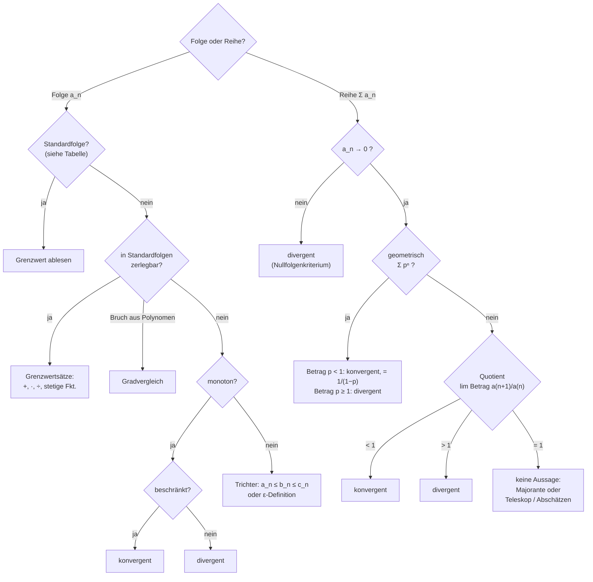

# Folgen
> [!NOTE] Folge ${}(a_n)_{n \in D}{}$
> Durchnummerierte Zahlen ${}a_0, a_1, a_2, \dots{}$ --> ${}n{}$ = **Folgenindex** (oft Zeit: Jahr, Periode), ${}a_n{}$ = ${}n{}$-tes **Folgenglied**
> - **explizit:** ${}a_n{}$ direkt als Formel in ${}n{}$ (z.B. ${}a_n = \frac1n{}$) --> Glied ohne Vorgänger berechenbar
> - **rekursiv (implizit):** nächstes Glied aus dem vorherigen (z.B. ${}a_{n+1} = a_n + 250{}$)

## Wichtige Folgen
| | explizit | rekursiv | Beispiel |
| --- | --- | --- | --- |
| **arithmetisch** | ${}a_n = a_0 + d \cdot n{}$ | ${}a_{n+1} = a_n + d{}$ | Sparen ohne Zinsen, lineare Abschreibung |
| **geometrisch** | ${}a_n = c \cdot p^n{}$ | ${}a_{n+1} = p \cdot a_n{}$ | Sparen mit Zinsen, exponentielles Wachstum |

- arithmetisch: **fester Abstand** ${}d = a_{n+1} - a_n{}$
- geometrisch: **fester Quotient** ${}p = \frac{a_{n+1}}{a_n}{}$

**Beispiel** (Konto, ${}K_0 = 2000{}$, ${}n = 0{}$ ≙ 2024):
- jährlich ${}+250{}$: ${}K_n = 2000 + 250n{}$ (arithmetisch) --> ${}K_n \ge 5000 \iff n \ge 12{}$
- jährlich ${}+5\,\%{}$: ${}K_n = 2000 \cdot 1{,}05^n{}$ (geometrisch) --> ${}1{,}05^n \ge 2{,}5 \iff n \ge 19{}$ (${}\log_{1,05}(2{,}5) \approx 18{,}78{}$)

# Summenfolgen
> [!NOTE] Summenzeichen
> $$\sum_{k=u}^{o} a_k = a_u + a_{u+1} + \dots + a_o$$
> ${}k{}$ = **Laufindex** (zählt die Summanden durch), ${}u{}$ = erster Wert, ${}o{}$ = letzter Wert
> **Partialsummenfolge:** ${}s_n = a_0 + a_1 + \dots + a_n = \sum_{k=0}^{n} a_k{}$ --> hängt von ${}n{}$ ab (wie viele Summanden)

- Konstante: ${}\sum_{i=1}^{10} a_n = 10 \cdot a_n{}$ (${}a_n{}$ hängt nicht von ${}i{}$ ab)
- **Indexverschiebung:** ${}\sum_{k=4}^{8} (k-1)^2 = \sum_{k=3}^{7} k^2{}$ (Grenzen um 1 runter, im Term um 1 rauf)

## Geometrische Summe
$$\sum_{k=0}^{n} q^k = 1 + q + q^2 + \dots + q^n = \frac{1-q^{n+1}}{1-q} \qquad (q \neq 1)$$

**Herleitung** (${}s_n - q \cdot s_n{}$-Trick):
$$s_n = 1 + q + q^2 + \dots + q^n$$
$$q \cdot s_n = \phantom{1 +{}} q + q^2 + \dots + q^n + q^{n+1}$$
--> abziehen, die Mitte kürzt sich weg:
$$s_n - q\,s_n = 1 - q^{n+1} \;\Rightarrow\; s_n(1-q) = 1 - q^{n+1} \;\Rightarrow\; s_n = \frac{1-q^{n+1}}{1-q}$$
- Multiplizieren mit ${}q{}$ schiebt jeden Summanden **eine Stelle weiter** --> funktioniert nur bei **festem** ${}q{}$

**Anwendung** (Konto mit Zinsfaktor ${}q{}$ und Einzahlung ${}r{}$): ${}K_{n+1} = K_n \cdot q + r{}$
$$K_n = K_0 q^n + r(1 + q + \dots + q^{n-1}) = K_0 q^n + r \cdot \frac{q^n - 1}{q - 1}$$

## Summenformeln
| Summe | Formel |
| --- | --- |
| geometrisch | ${}\sum_{k=0}^{n} x^k = \frac{1-x^{n+1}}{1-x}{}$ (${}x \ne 1{}$) |
| Gauß | ${}\sum_{k=1}^{n} k = \frac{n(n+1)}{2}{}$ |
| Quadrate | ${}\sum_{k=1}^{n} k^2 = \frac16 n(n+1)(2n+1){}$ |
| Kuben | ${}\sum_{k=1}^{n} k^3 = \frac14 n^2(n+1)^2{}$ |
| binomisch | ${}\sum_{i=0}^{n} \binom{n}{i} x^i y^{n-i} = (x+y)^n{}$ |

## Vollständige Induktion
${}A(n){}$ gilt für alle ${}n \ge n_0{}$, wenn:
1. **Induktionsanfang:** ${}A(n_0){}$ ist wahr
2. **Induktionsschritt:** aus ${}A(n){}$ (Induktionsvoraussetzung) folgt ${}A(n+1){}$

--> Formel muss **vorher schon vermutet** sein, Induktion beweist sie nur

# Grenzwerte von Folgen
> [!NOTE] Konvergenz
> ${}(a_n){}$ **konvergiert** gegen ${}a{}$, wenn es zu jedem ${}\epsilon > 0{}$ ein ${}n_0{}$ gibt mit
> $$\lvert a_n - a \rvert < \epsilon \quad \text{für alle } n \ge n_0$$
> --> ab irgendeinem Glied liegen **alle** weiteren Glieder beliebig nah an ${}a{}$
> - Schreibweise: ${}\lim_{n\to\infty} a_n = a{}$ bzw. ${}a_n \to a{}$
> - **Nullfolge:** Grenzwert ${}0{}$
> - **divergent:** nicht konvergent
> 	- **bestimmt divergent:** ${}a_n \to +\infty{}$ oder ${}-\infty{}$
> 	- **unbestimmt divergent:** springt, z.B. ${}(-1)^n{}$

- Konvergenz hängt **nicht vom Anfang** ab, nur vom Verhalten für große ${}n{}$
- Definition liefert den Grenzwert **nicht**, man muss ihn vorher kennen

## Notwendige Bedingung: Beschränktheit
**Jede konvergente Folge ist beschränkt** (${}\lvert a_n \rvert \le M{}$ für alle ${}n{}$)
--> umgekehrt: **unbeschränkt ⇒ divergent**

**Beispiel:** harmonische Reihe ${}a_n = 1 + \frac12 + \dots + \frac1n{}$ ist unbeschränkt:
$$a_{2n} - a_n = \frac{1}{n+1} + \dots + \frac{1}{2n} \ge n \cdot \frac{1}{2n} = \frac12$$
--> bei jeder Verdopplung von ${}n{}$ mindestens ${}+\frac12{}$ --> ${}a_{2^m} \ge \frac m2 \to \infty{}$

## Grenzwert per Definition
1. ${}\lvert a_n - a \rvert{}$ vereinfachen bzw. nach oben abschätzen
2. ${}< \epsilon{}$ nach ${}n{}$ auflösen --> ${}n_0{}$

**Beispiel:** ${}\frac{n}{n+1} \to 1{}$, denn ${}\left\lvert \frac{n}{n+1} - 1 \right\rvert = \frac{1}{n+1} \le \frac1n < \epsilon \iff n > \frac1\epsilon{}$
- Abschätzung nicht **zu grob**: Schlussterm muss Nullfolge sein (${}\le 1{}$ hilft nicht)

## Trichterprinzip
> [!NOTE] Trichter
> ${}a_n \le b_n \le c_n{}$ und ${}a_n \to x{}$, ${}c_n \to x{}$ ⇒ ${}b_n \to x{}$

- z.B. ${}p^n \to 0{}$ für ${}0 < p < 1{}$; ${}\left(1 + \frac1n\right)^n \to e{}$

## Standardgrenzwerte
| Folge ${}a_n{}$ | Bedingung | Verhalten |
| --- | --- | --- |
| ${}c{}$ (konstant) | — | ${}\to c{}$ |
| ${}\frac{1}{n^a}{}$ | ${}a > 0{}$ | Nullfolge |
| ${}n^a{}$ | ${}a > 0{}$ | bestimmt divergent ${}\to \infty{}$ |
| ${}p^n{}$ (geometrisch) | ${}-1 < p < 1{}$ | Nullfolge |
| | ${}p = 1{}$ | ${}\to 1{}$ |
| | ${}p > 1{}$ | bestimmt divergent ${}\to \infty{}$ |
| | ${}p \le -1{}$ | unbestimmt divergent (springt) |
| ${}\left(1 + \frac{x}{n}\right)^n{}$ | ${}x \in \mathbb{R}{}$ | ${}\to e^x{}$ |

## Grenzwertsätze
Wenn ${}a_n \to a{}$ und ${}b_n \to b{}$ (**beide konvergent**):
- ${}a_n \pm b_n \to a \pm b{}$
- ${}a_n \cdot b_n \to a \cdot b{}$
- ${}\frac{a_n}{b_n} \to \frac ab{}$ (falls ${}b \ne 0{}$)
- ${}f(a_n) \to f(a){}$ für stetiges ${}f{}$

--> Folge in Standardfolgen **zerlegen**, dann Grenzwerte zusammensetzen

## Gebrochen-rationale Folgen ${}a_n = \frac{p(n)}{q(n)}{}$
**Trick:** durch die höchste Potenz des Nenners teilen
$$\frac{1 + 3n + 4n^2}{2 + 5n^2} = \frac{\frac{1}{n^2} + \frac3n + 4}{\frac{2}{n^2} + 5} \;\to\; \frac{0 + 0 + 4}{0 + 5} = \frac45$$

| Grad | Verhalten |
| --- | --- |
| ${}\text{grad}(p) > \text{grad}(q){}$ | bestimmt divergent |
| ${}\text{grad}(p) = \text{grad}(q) = r{}$ | konvergent, ${}\to \frac{\alpha_r}{\beta_r}{}$ (Leitkoeffizienten) |
| ${}\text{grad}(p) < \text{grad}(q){}$ | Nullfolge |

## Monotoniekriterium
> [!NOTE] Monotonie + Beschränktheit
> Für eine **monoton wachsende (oder fallende)** Folge gilt:
> $$(a_n) \text{ konvergent} \iff (a_n) \text{ beschränkt}$$
> --> **monoton + beschränkt ⇒ konvergent** (Grenzwert = Supremum bzw. Infimum)

- wachsend: Schranke **nach oben** nötig, fallend: Schranke **nach unten** nötig
- zeigt Konvergenz, **ohne den Grenzwert zu kennen**

**Beispiel:** ${}a_n = \sum_{k=1}^{n} \frac{1}{k^2}{}$
- **monoton wachsend:** ${}a_{n+1} - a_n = \frac{1}{(n+1)^2} > 0{}$
- **beschränkt:** jeden Summanden **vergrößern**, sodass man exakt rechnen kann:
$$a_n = 1 + \tfrac12 \cdot \tfrac12 + \dots + \tfrac1n \cdot \tfrac1n \;\le\; 1 + \tfrac11 \cdot \tfrac12 + \dots + \tfrac{1}{n-1} \cdot \tfrac1n$$
- **Teleskop:** ${}\frac{1}{k-1} \cdot \frac1k = \frac{1}{k-1} - \frac1k{}$ --> Nachbarn heben sich weg:
$$= 1 + \left(1 - \tfrac12\right) + \left(\tfrac12 - \tfrac13\right) + \dots + \left(\tfrac{1}{n-1} - \tfrac1n\right) = 2 - \tfrac1n \le 2$$
- Logik: ${}a_n \le (\text{größere Summe}) \le 2{}$ --> wenn schon die größere unter 2 bleibt, dann erst recht ${}a_n{}$ (nur **nach oben** vergrößern!)
- --> konvergent (Grenzwert ${}\frac{\pi^2}{6}{}$)

# Unendliche Reihen
> [!NOTE] Reihe
> $$\sum_{n=k}^{\infty} a_n := \lim_{n\to\infty} \underbrace{(a_k + a_{k+1} + \dots + a_n)}_{S_n \text{ (Partialsumme)}}$$
> --> Reihe = **Folge der Zwischenstände** ${}S_n{}$, konvergiert, wenn ${}S_n{}$ konvergiert

## Nullfolgenkriterium
**Reihe konvergiert ⇒ ${}a_n \to 0{}$** (Umkehrung falsch!)
- ${}a_n = S_n - S_{n-1}{}$ = **Schritt** von einem Zwischenstand zum nächsten
- konvergiert ${}S_n \to S{}$, dann ${}a_n = S_n - S_{n-1} \to S - S = 0{}$
- --> die **Schritte** gehen gegen 0, die **Summe** gegen ${}S{}$ (meist ${}\neq 0{}$)

**Anwendung:** ${}a_n \not\to 0{}$ ⇒ Reihe **divergent** (schneller Ausschluss-Test)
**Umkehrung falsch:** harmonische Reihe ${}\sum \frac1n{}$: ${}\frac1n \to 0{}$, aber divergent (Schritte werden **zu langsam** kleiner)

## Geometrische Reihe
$$\sum_{n=0}^{\infty} p^n = \frac{1}{1-p} \quad \text{für } \lvert p \rvert < 1 \qquad (\lvert p \rvert \ge 1\text{: divergent})$$

**So rechnet man es:**
1. Partialsumme mit der geometrischen Summenformel: ${}S_n = \frac{1-p^{n+1}}{1-p}{}$
2. Grenzwert: für ${}\lvert p \rvert < 1{}$ gilt ${}p^{n+1} \to 0{}$ (Standardgrenzwert)
3. Grenzwertsätze: ${}S_n \to \frac{1-0}{1-p} = \frac{1}{1-p}{}$

**Typische Fälle:**
- **Start nicht bei ${}0{}$:** ${}\sum_{n=1}^{\infty} p^n = \frac{1}{1-p} - 1 = \frac{p}{1-p}{}$ (Summand ${}p^0 = 1{}$ fehlt)
- **Faktor davor:** ${}\sum_{n=0}^{\infty} c \cdot p^n = \frac{c}{1-p}{}$
- **allgemein:** ${}\frac{\text{erstes Glied}}{1-p}{}$, z.B. ${}\sum_{n=2}^{\infty} \left(\tfrac12\right)^n = \frac{1/4}{1-1/2} = \frac12{}$

## Rechenregeln (nur wenn beide Reihen konvergent)
- Summenregel: ${}\sum (a_n + b_n) = \sum a_n + \sum b_n{}$
- Faktorregel: ${}\sum c\,a_n = c \cdot \sum a_n{}$

**Beispiel:**
$$\sum_{n=0}^{\infty} \left(\left(\tfrac12\right)^n + 2 \cdot \left(\tfrac13\right)^n\right) = \frac{1}{1-\frac12} + 2 \cdot \frac{1}{1-\frac13} = 2 + 3 = 5$$
- Bedingung wichtig: ${}\sum(1 + (-1)) = 0{}$, aber ${}\sum 1 + \sum(-1) = \infty - \infty{}$ (undefiniert)

## Konvergenzkriterien für Reihen
> [!NOTE] Majorantenkriterium
> ${}\lvert a_k \rvert \le b_k{}$ und ${}\sum b_k{}$ konvergent ⇒ ${}\sum a_k{}$ konvergent
> --> durch eine **größere**, konvergente Reihe abschätzen (oft geometrisch)

- z.B. ${}\sum \frac1n p^n{}$ für ${}\lvert p \rvert < 1{}$, da ${}\left\lvert \frac1n p^n \right\rvert \le \lvert p \rvert^n{}$

> [!NOTE] Quotientenkriterium
> $$\lim_{n\to\infty} \left\lvert \frac{a_{n+1}}{a_n} \right\rvert < 1 \Rightarrow \text{konvergent}, \qquad > 1 \Rightarrow \text{divergent}, \qquad = 1 \Rightarrow \text{keine Aussage}$$
> --> verhält sich am Ende wie eine geometrische Reihe

- z.B. ${}\sum n p^n{}$ mit ${}\lvert p \rvert < 1{}$: ${}\left\lvert \frac{(n+1)p^{n+1}}{n p^n} \right\rvert = \lvert p \rvert \cdot \frac{n+1}{n} \to \lvert p \rvert < 1{}$ --> konvergent (Wert ${}\frac{p}{(1-p)^2}{}$)
- Kriterien sagen nur **ob**, nicht **wogegen**

## Potenzreihen ${}\sum_{k=0}^{\infty} a_k x^k{}$
| Reihe | Wert | gültig für |
| --- | --- | --- |
| ${}\sum_{k=0}^{\infty} x^k{}$ | ${}\frac{1}{1-x}{}$ | ${}\lvert x \rvert < 1{}$ |
| ${}\sum_{k=0}^{\infty} \frac{x^k}{k!}{}$ | ${}e^x{}$ | alle ${}x{}$ |
| ${}\sum_{k=0}^{\infty} (-1)^k \frac{x^{2k}}{(2k)!}{}$ | ${}\cos(x){}$ | alle ${}x{}$ |
| ${}\sum_{k=0}^{\infty} (-1)^k \frac{x^{2k+1}}{(2k+1)!}{}$ | ${}\sin(x){}$ | alle ${}x{}$ |

# Übersicht: Konvergent oder divergent?
## Entscheidungsweg

## Reihen: Standardfälle
| Reihe | Bedingung | Verhalten |
| --- | --- | --- |
| ${}\sum_{n=0}^{\infty} p^n{}$ (geometrisch) | ${}\lvert p \rvert < 1{}$ | konvergent, ${}= \frac{1}{1-p}{}$ |
| | ${}\lvert p \rvert \ge 1{}$ | divergent |
| ${}\sum_{n=1}^{\infty} \frac{1}{n}{}$ (harmonisch) | — | divergent (obwohl ${}\frac1n \to 0{}$!) |
| ${}\sum_{n=1}^{\infty} \frac{1}{n^2}{}$ | — | konvergent (${}\le 2{}$, genau ${}\frac{\pi^2}{6}{}$) |
| ${}\sum_{n=1}^{\infty} n\,p^n{}$ | ${}\lvert p \rvert < 1{}$ | konvergent, ${}= \frac{p}{(1-p)^2}{}$ |
| ${}\sum_{k=0}^{\infty} \frac{x^k}{k!}{}$ | ${}x \in \mathbb{R}{}$ | konvergent, ${}= e^x{}$ |
| ${}\sum a_n{}$ mit ${}a_n \not\to 0{}$ | — | divergent |

## Kriterien
| Kriterium | gilt für | Aussage |
| --- | --- | --- |
| **Beschränktheit** | Folgen | konvergent ⇒ beschränkt --> unbeschränkt ⇒ **divergent** |
| **Monotonie** | Folgen | monoton **und** beschränkt ⇒ **konvergent** |
| **Trichter** | Folgen | ${}a_n \le b_n \le c_n{}$, ${}a_n, c_n \to x{}$ ⇒ ${}b_n \to x{}$ |
| **Grenzwertsätze** | Folgen | Grenzwerte von ${}\pm, \cdot, \div{}$ zusammensetzen (beide konvergent) |
| **Nullfolgenkriterium** | Reihen | ${}a_n \not\to 0{}$ ⇒ **divergent** (${}a_n \to 0{}$ ⇒ noch nichts!) |
| **Majorante** | Reihen | ${}\lvert a_k \rvert \le b_k{}$, ${}\sum b_k{}$ konvergent ⇒ **konvergent** |
| **Quotient** | Reihen | ${}< 1{}$ ⇒ konvergent, ${}> 1{}$ ⇒ divergent, ${}= 1{}$ ⇒ keine Aussage |

## Was folgt woraus? (Fallen)
| Aussage | stimmt? | Gegenbeispiel |
| --- | --- | --- |
| konvergent ⇒ beschränkt | ✅ | — |
| beschränkt ⇒ konvergent | ❌ | ${}(-1)^n{}$ |
| monoton ⇒ konvergent | ❌ | ${}a_n = n{}$ |
| monoton + beschränkt ⇒ konvergent | ✅ | — |
| konvergent ⇒ monoton | ❌ | ${}\frac{(-1)^n}{n} \to 0{}$ |
| ${}\sum a_n{}$ konvergent ⇒ ${}a_n \to 0{}$ | ✅ | — |
| ${}a_n \to 0{}$ ⇒ ${}\sum a_n{}$ konvergent | ❌ | ${}\sum \frac1n{}$ |

> [!TIP] Prüfreihenfolge
> **Folge:** Standardfall --> zerlegen (GWS) --> Gradvergleich --> monoton + beschränkt --> Trichter
> **Reihe:** erst ${}a_n \to 0{}$? (sonst sofort divergent) --> geometrisch? --> Quotient --> Majorante
