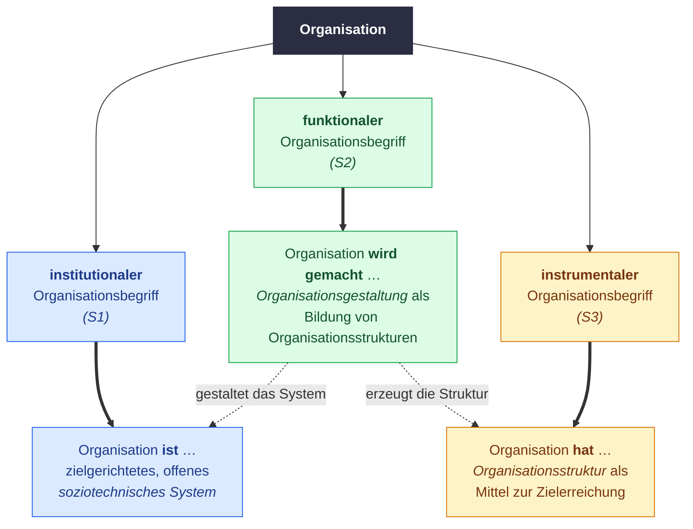

# Organisationsbegriffe

| Begriff                | Kernaussage                                                   |
| ---------------------- | ------------------------------------------------------------- |
| **institutional (S1)** | zielgerichtetes, offenes, soziotechnisches System             |
| **funktional (S2)**    | Organisationsgestaltung = Bildung von Organisationsstrukturen |
| **instrumental (S3)**  | Organisationsstruktur = Mittel zur Zielerreichung             |

## Aufbau- vs. Ablauforganisation
|                | **Aufbauorganisation**                                          | **Ablauforganisation**                                       |
| -------------- | --------------------------------------------------------------- | ------------------------------------------------------------ |
| **Gegenstand** | Gliederung in Teileinheiten (Stellen, Abteilungen, Gremien)     | Ablauf des betrieblichen Geschehens                          |
| **Aufgabe**    | ordnet Aufgaben + Kompetenzen zu, koordiniert die Teileinheiten | regelt Ausübung der Funktionen innerhalb **und** zwischen den Teileinheiten |

## Stelle
- **Definition**: Kleinste aufbauorganisatorische Einheit --> entsteht durch dauerhafte Zuordnung von Aufgaben auf eine oder mehrere Personen
- **Merkmale**:
	1. **Aufgabe**: Zuständigkeitsbereich
	2. **Kompetenz**: formale Rechte und Befugnisse
	3. **Verantwortung**: Pflicht zur persönlichen Rechenschaft
- **Kongruenzprinzip**: Aufgabe, Kompetenz und Verantwortung sollen übereinstimmen

## Stellenarten
| Stellenart                | Kompetenzen                                        | Funktion                                                                               | Bsp.                                  |
| ------------------------- | -------------------------------------------------- | -------------------------------------------------------------------------------------- | ------------------------------------- |
| **Ausführungsstelle**     | **keine** Leitungskompetenzen                      | erledigt operative Aufgaben                                                            | Sachbearbeiter, Monteur               |
| **Leitungsstelle**        | Fremdentscheidungs-, Weisungs- + Kontrollkompetenz | entscheidet für andere, gibt Anweisungen, kontrolliert                                 | Abteilungsleiter, Vorstand            |
| **Stabsstelle**           | **keine** Fremdentscheidungs- + Weisungskompetenz  | spezialisierte Leitungshilfe mit fachspezifischen Aufgaben für **eine** Leitungsstelle | Vorstandsassistenz, Strategiereferent |
| **Dienstleistungsstelle** | i.d.R. keine Weisungskompetenz                     | Unterstützungsaufgaben für **mehrere** Leitungsstellen --> bereichsübergreifend         | Rechtsabteilung, IT-Support           |

## Organisationsaufbau: Leitungsspanne, -tiefe, -intensität
- **Leitungsspanne** $s$: Anzahl direkt unterstellter Stellen je Leitungsstelle
- **Leitungstiefe**: Anzahl der Hierarchieebenen
- **Leitungsintensität**: $\frac{\text{Leitungsstellen}}{\text{Ausführungsstellen}}$ --> wie viel "Leitung" pro Ausführungsstelle

| **Beispiel 1** | **Beispiel 2** |
| --- | --- |
| ![[BWL 07 Organisationsaufbau Beispiel 1.png\|400]] | ![[BWL 07 Organisationsaufbau Beispiel 2.png\|400]] |

|                         | **Beispiel 1**                     | **Beispiel 2**              |
| ----------------------- | ---------------------------------- | --------------------------- |
| **Stellenanzahl**       | $\frac{3^4-1}{3-1} = 40$           | $\frac{6^3-1}{6-1} = 43$    |
| **Leitungsstellen**     | $1+3+9 = 13$                       | $1+6 = 7$                   |
| **Ausführungsstellen**  | $27$ (unterste Ebene)              | $36$ (unterste Ebene)       |
| **Leitungsintensität**  | $\frac{13}{27} \approx 0{,}48$     | $\frac{7}{36} \approx 0{,}19$ |
- **Stellenanzahl** = geometrische Reihe: $\frac{s^{n}-1}{s-1}$ mit $n$ = Anzahl Ebenen
- **Fazit**: Größere Leitungsspanne --> flachere Hierarchie (weniger Ebenen) + geringere Leitungsintensität (weniger Chefs pro Ausführungsstelle)

## Interdependenzen
- **Ausgangspunkt**: Stellen werden zu Abteilungen zusammengefasst --> zwischen Abteilungen bestehen gegenseitige Abhängigkeiten
- **Arten**:
	1. **Innerbetriebliche Leistungsverflechtungen**: Output einer Abteilung = Input einer anderen (z.B. Fertigung --> Montage)
	2. **Ressourceninterdependenzen**: Abteilungen teilen knappe Ressourcen (Budget, Maschinen, Personal) --> mehr für A = weniger für B
	3. **Marktinterdependenzen**: Abteilungen agieren auf demselben Absatz- oder Beschaffungsmarkt --> Entscheidung der einen beeinflusst Erfolg der anderen (z.B. Kannibalisierung)

### Abstimmungsprobleme bei interdependenten Funktionsbereichen
| Konflikt                       | Zielkonflikt                                                                             |
| ------------------------------ | ---------------------------------------------------------------------------------------- |
| **Beschaffung vs. Produktion** | reibungsloser Fertigungsablauf (viel Lager) vs. geringer Materiallagerbestand            |
| **Produktion vs. Marketing**   | Kosten vs. Nutzen der Sortimentsvielfalt (Spezialprodukte)                               |
| **Produktion vs. Vertrieb**    | termingerechte Lieferung vs. rationelle Fertigung                                        |
| **Produktion vs. Finanzen**    | Kosteneinsparung durch flexibles Fertigungssystem vs. Einhaltung des Investitionsbudgets |
**Kern**: Jede Abteilung optimiert ihr eigenes Ziel --> schadet ggf. dem Gesamtziel --> Koordination nötig

## Organisationsformen: Typisierung
|                               | **Funktionale Organisation**                                                | **Geschäftsbereichsorganisation**                                          |                                                                           |                       |
| ----------------------------- | --------------------------------------------------------------------------- | -------------------------------------------------------------------------- | ------------------------------------------------------------------------- | --------------------- |
| **Gruppierungskriterium**     | Funktionen                                                                  | Produkte                                                                   | Regionen                                                                  | Kundengruppen         |
| **Bsp. Pollmann**             | ![[BWL 07 Organigramm 1 funktional.png\|250]]                               | ![[BWL 07 Organigramm 3 Produkte.png\|250]]                                | ![[BWL 07 Organigramm 2 Regionen.png\|250]]                               | –                     |
| **Anwendungsbedingungen**     | homogenes Leistungsprogramm, stabile Umwelt, kleine u. mittlere Unternehmen | heterogenes Leistungsprogramm, Großunternehmen                             | heterogenes Leistungsprogramm, Großunternehmen                            | heterogenes Leistungsprogramm, Großunternehmen |
| **Typische Interdependenzen** | innerbetriebliche Leistungsverflechtungen                                   | Markt (**Absatz**) + Ressourcen                                            | Markt (**Beschaffung**) + Ressourcen                                      | Markt (**Beschaffung**) + Ressourcen |
- **Faustregel**: Wonach gruppiert wird, ist getrennt --> wo Sparten gleich sind, entsteht die Interdependenz

## Überbetriebliche Kooperation
- **Zusammenarbeit** zwischen Unternehmen durch:
	- Abstimmung (Koordinierung) von Funktionen oder
	- Ausgliederung von Funktionen auf eine gemeinschaftliche Einrichtung
- **Selbstständigkeit**: Unternehmen bleiben rechtlich selbstständig + wirtschaftlich in allen Bereichen außerhalb der vertraglichen Zusammenarbeit
- **Ziele**:
	1. Kostensenkung durch Rationalisierung
	2. Höhere Marktmacht (z.B. gegenüber Lieferanten/Abnehmern)
	3. Ausnutzung von Spezialisierungsvorteilen
	4. Risikoverteilung auf mehrere Beteiligte

### Formen der Kooperation & Konzentration
| **Kooperationsformen** (Selbstständigkeit bleibt)  | **Konzentrationsformen** (Selbstständigkeit geht verloren) |
| -------------------------------------------------- | --------------------------------------------------------- |
| langfristige Liefer- und Abnahmeverpflichtungen    | (gegenseitige) Kapitalbeteiligungen                       |
| Interessen-, Arbeitsgemeinschaften                 | Konzernbildung                                            |
| Gelegenheitsgesellschaften (Konsortien)            | Fusion                                                    |
| Kartelle (i.d.R. **nicht legal**)                  |                                                           |
| Gemeinschaftsunternehmen (Joint Ventures)          |                                                           |
- **Reihenfolge**: von oben links nach unten rechts --> zunehmende Bindung, Fusion = stärkste Form (aus zwei wird eins)

### Unternehmensverbindungen
|              | **horizontal**                                        | **vertikal** (vorwärts oder rückwärts)                      | **anorganisch**         |
| ------------ | ----------------------------------------------------- | ----------------------------------------------------------- | ----------------------- |
| **Partner**  | gleiche Produktions-/Handelsstufe, gleiche Branche    | aufeinanderfolgende Produktions-/Handelsstufe               | verschiedene Branchen   |
| **Ziele**    | Ausschaltung Konkurrenz, Marktmacht, gemeinsame Projekte | Unabhängigkeit von fremden Lieferanten (rückwärts), Sicherung des Absatzes (vorwärts) | Risikodiversifikation |
| **Bsp.**     | Brauerei + Brauerei                                   | Brauerei + Hopfenbauer (rückw.) / + Getränkemarkt (vorw.)   | Dr. Oetker: Pudding + Reederei |
- **Merkhilfe**: horizontal = Partner **neben** mir --> Macht, vertikal = **vor/hinter** mir --> Sicherheit, anorganisch = **woanders** --> weniger Risiko
